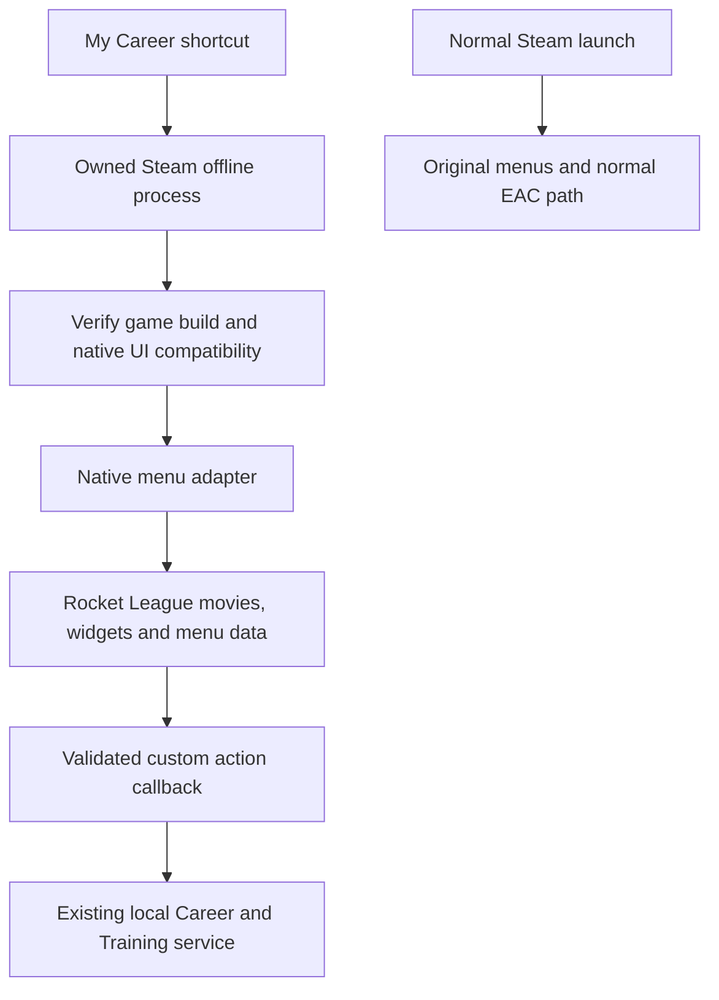

# Native My Career menus: implementation decision and experiments

Research reviewed **23 October 2026** against project commit
`15f713a4b342122e20d2d9cdedb55b1588f10bb6`. This is an implementation plan,
not a working native-menu release. Six GPT-6 Luna Max research tracks covered
Rocket League precedents, package editing, other games, process isolation,
official policy, and the current project's integration gaps.

## The answer to “why not change the menu files?”

Game menus can be modified. They are not necessarily fixed pictures baked into
the executable. Rocket League's native UI has Scaleform movies, backing data,
and game code that handles actions. Editing the movie can change its appearance;
changing the backing data and action handlers can change its behavior.
Epic's [UE3 Scaleform guide][ue3] documents runtime manipulation of this kind of
interface. Public Rocket League metadata identifies corresponding GFx/menu
classes, although it does not prove a working modification on the player's PC.

Other games provide concrete examples. Batman: Arkham City has a documented
UE3 movie export/edit/import workflow. Fallout 4 MCM attaches a custom movie to
the native main menu and connects input and callbacks. Minecraft FancyMenu
changes actual screen widgets. See the [verified precedents][precedents] for
source links and the limits of each comparison. These examples rebut “menus
cannot be modified”; they do not establish Rocket League compatibility.

**Decision:** build a native menu adapter that operates inside the owned offline
Rocket League process. Prefer changing its existing menu data/widgets and
replacing their action routes. If that cannot produce a required screen, test
a locally modified UI package supplied through a process-specific file view.
Do not use an overlay or a modal dialog as proof that the stock menu changed.

This design uses the existing Steam installation. It does not require a second
complete game download. The downloadable mod would contain our code and any
mod-authored UI material; Rocket League assets would remain local dependencies. If a package
patch is required, generate its output locally from the user's matching files,
outside the Steam installation. Its size and loadability are not yet known.

## Concrete Rocket League targets

The inspected [unofficial RLSDK snapshot][rlsdk] is pinned to commit
`8867776ced2fdc39eca38733e6989213029905a5`, dated 22 October 2026. Its
`SdkHeaders.hpp` identifies Steam version 2.78, build `261013.63066.530866`.
It has no inspected license grant. Treat its declarations as research leads:
do not vendor its code or use its fixed offsets as a working adapter.

| Requested behavior | Specific research target | What must be established before use |
|---|---|---|
| Find the visible native screen | `UGFxShell_X.Movies` / `DataStore`; `UGFxData_MainMenu_TA.MainMenuAdded`, `OnEnteredMainMenu`, `HandleTopMenuChange` | Which live movie and data source own the **home screen**, on the exact installed build. |
| Rename a native choice | `UMenuTreeNode_TA.Title` / `TitleKey`; `UGFxDataStore_X.SetStringValue`; movie `SetVariableString` or object `SetText` | The actual bound row or symbol, localization behavior, and refresh mechanism. A field write alone may be overwritten or never repaint. |
| Remove unwanted choices | `UMenuTreeBranch_TA.ChildNodes` / `SetChildren`; node `IsVisible` / `IsNodeEnabled`; `UGFxData_MenuTreeNode_TA.bEnabled` | Which tree owns the choice, removal from focus and selection, and whether the enabled checker/tree rebuild restores it. |
| Give a choice a new action | `OnChildNodeClicked`, `UMenuTreeNode_TA.OnClicked`, menu-stack `ButtonTriggered`; GFx function/event bridge | An actual replacement/consume point **before** the original action. Observing an event after it fires is insufficient. |
| Open native Career screens | Existing movie/data-store bindings; `UMenuTreeNode_ExternalScreen_TA.ScreenToOpen`; validated GFx host callback | A real registered screen or supported movie construction path. Changing a screen name cannot create a nonexistent screen. |
| Make Back return to Career | `UGFxData_MenuStack_TA.PushMenu` / `PopMenu`; tree `OnBackClicked`; movie lifecycle | Behavior from home, submenus, match pause, match results, and training. These may be different movies and action routes. |

Pinned declarations: [GFx movie/object][gfx], [shell/data store][shell],
[tree nodes and click handlers][tree], [branches and builder][branches],
[menu stack][stack], [main-menu data][mainmenu], and
[enabled state / external-screen node][node-data].

**Important distinction:** the `MenuTree` classes appear connected to Play and
playlist navigation. There is no proof that `SetChildren` edits the top-level
Play/Garage/Settings home menu. If it only owns Play, use it there and separately
identify the home movie's bound controls. Do not report a playlist edit as a
main-menu replacement.

## Chosen runtime design

The diagram is the intended architecture, not a receipt of successful launch.
The existing C++ plugin is a candidate host only after current-build loading is
proven. Compiling against BakkesMod's SDK does not prove its runtime works on
that build, even with EAC off. If it does not, a compatible loader/runtime is a
separate prerequisite, not a setting to bypass. Changing languages would not
supply missing game interfaces. Python can keep managing career data. Native GFx
ActionScript is needed only where existing widgets cannot express a screen.

Current host evidence is better than the older shutdown headlines suggest:
the official [BakkesMod 2.0.78 release][bm-release], published **20 October 2026**,
is labeled `RL2.78/BM229` and lists Steam build `25914621`. Its updater metadata
agreed when checked. This supersedes the April announcement as a reason to
declare the host unavailable. It still does not prove our plugin loads on the
player's exact installation or provide native-menu editing APIs. Experiment 0
checks that remaining boundary.

1. **Bind an exact build.** Validate the executable hash, game build, plugin/host
   version, and relevant movie/package identities. Resolve the UI owner and
   callable signatures using independently verified, usable interfaces. A known
   hash identifies bytes; it does not establish a safe ABI or object lifetime.
   Unknown or ambiguous versions must not perform menu mutations.
2. **Own native input before exposing the career home.** Determine when the home
   movie becomes interactive and when the plugin can attach. A late BakkesMod
   injection may leave a stock menu interactive first. Prove an early native
   initialization/input gate or choose an earlier compatible loader; repeated
   `openmenu` calls or drawing over stock buttons do not solve this.
3. **Adapt the real controls.** Keep the game's layout, animation, sounds and
   fonts wherever available. Supply Career, Training, Schedule, Season, Squad,
   Garage, Workshop, Settings and Exit through native controls. Exclude online
   matchmaking, tournaments and account/store routes from this session. Each
   new control needs a real implemented destination, not just a changed label.
   Reuse existing native nodes where possible. New Unreal nodes also require
   valid ownership, parent links, matching GFx data rows and garbage-collection
   lifetime; an array of new labels is not enough.
4. **Replace actions, not just text.** Remove unwanted controls from display,
   mouse hit testing and keyboard/controller focus. Replace or consume their
   original route before dispatch. Keep an offline-only action allowlist in our
   backend too. This is not an EAC bypass; the session must already be in the
   game's supported EAC-off mode.
5. **Use a proven callback bridge.** UE3 documents delegates and GFx event
   binding; Autodesk documents [host/movie communication][autodesk]. Neither
   makes an arbitrary plugin C++ lambda callable by Rocket League. Verify the
   receiving host object/function and calling convention, or implement a
   compatible native bridge. Queue typed intents into the existing
   nonce/generation-checked flow. Never forward arbitrary console commands.
6. **Respect object lifetime.** Resolve objects on the game thread, snapshot
   only owned changes, invalidate bindings on movie/world destruction, and
   reacquire on creation. Restore surviving properties only if they still
   match our writes. Do not retain dangling native pointers or overwrite
   another plugin's changes. Demonstrate that the menu does not save these
   changes into shared settings, profiles or packages.
7. **Contain failures.** Before compatibility succeeds, do not announce a ready
   My Career session. If ownership, backend freshness or native input control
   fails, stop accepting career actions and use a verified recovery/exit path.
   Do not silently restore an interactive stock menu while presenting the
   session as locked My Career. A normal Steam launch must remain independent.

Epic's [Scaleform quick start][quickstart] describes building and importing
movies through engine authoring tools. That is background documentation, not
evidence that Rocket League ships a mod editor or accepts arbitrary new movies.

## File-editing fallback: change a local menu package, not Steam's copy

Candidate names include `GFX_MainMenu_SF.upk`, `GFX_PlayMenuV4_SF.upk`,
`GFX_SettingsMenu_SF.upk`, `GFX_TrainingBrowserMenu_SF.upk` and
`GFxShell_SF.upk`. The [historical graphics inventory][graphics] identifies
several such names but targets a **2023** build and contains extracted game
assets. It is a naming lead only; do not download its assets. Establish current
paths, movie exports and dependencies from the player's installed files.

The file-based pipeline has five distinct stages:

1. Inspect and extract the needed movie locally. [UModel][umodel] is an
   exporter; the [RLBot extraction guide][rlbot-extract] documents Rocket League
   extraction, not menu repacking.
2. Edit the extracted movie. [JPEXS][jpexs] documents SWF/GFX editing, but generic
   support does not establish a lossless Rocket League movie round trip.
3. Rebuild a valid package. [UPK Explorer][upk] documents movie import in some
   UE3 games, not verified Rocket League support. [RLUPKTools][rlupk] targets
   Rocket League package editing, but its inspected source does not implement
   arbitrary SWF/GFX import. It has no inspected license grant; do not copy or
   bundle its code or key material. **A suitable menu-package writer is still
   an implementation gap.**
4. Supply the result only to the offline game process. [Reloaded's file
   redirector][redirector] and [USVFS][usvfs] demonstrate process-specific file
   views in other mod ecosystems. Rocket League compatibility remains
   unverified. The loader must be active before the UI package is opened or
   cached; [Reloaded's startup modes][loader] explain why late attachment can
   miss that point. Selective redirection must cover the actual file-open path
   and preserve Steam's original view.
5. Bind the changed buttons to our service and test them. File redirection
   changes which bytes load; it does not implement a native Career action.

First test an unchanged movie/package round trip, then a harmless text edit,
then one custom action. If the unchanged round trip cannot load, do not debug
Career logic inside that invalid package. Check dependent assets, object
references, movie version and package compression before proceeding.

Directly replacing a Steam package is technically a different option, but
does not meet this project's preservation requirement. A crash can leave the
modified file behind before the next ordinary Steam launch. Backups and a
recovery journal cannot remove that interval. Hard links share file contents;
junctions change the path for other processes as well. Neither provides the
needed isolated view. [Microsoft's link documentation][links] explains the
shared-file behavior. [Steam verification][steam-verify] can repair files; it
does not test mod behavior. Do not require users to repair Steam after playing.

## Experiments that decide the implementation

These are ordered engineering experiments, not a request for the player to
manually reverse engineer their game. Record a separate outcome for each.

| Experiment | Required observable result | If it fails |
|---|---|---|
| **0. Current offline plugin host** | A minimal plugin actually loads and unloads on the exact current Steam build with EAC off, with working game-thread execution and process ownership checks. | Find or implement a compatible loader/runtime first. Do not force an outdated host to attach or treat SDK compilation as runtime compatibility. |
| **1. Identify native ownership** | Exact game fingerprint; home/Play/pause/results movie identities; bound labels, IDs, parent/child relationships, original action target, object lifetime and callable layout. Record the earliest interactive frame and loader readiness. | Extend read-only inspection using verified interfaces. Names from a generated header or the existing event-only probe do not pass. No speculative writes. |
| **2. Reversible native label** | Change one harmless home-menu control's displayed label; keep its native animation and input; restore it; repeat after menu recreation. Demonstrate a native object changed, not an added panel. | Determine whether localization/data binding overwrote it or the wrong movie owns it. If there is no usable runtime path, evaluate the package round trip. |
| **3. Native visibility and routing** | For a harmless offline control, prove hidden/disabled means no mouse, keyboard or controller activation; then replace its action with one local Career callback. Callback fires once and the original handler does not run. | Find a pre-action consume/replacement point. A post-event callback or changing a label is a failed result, even if the screen looks correct. |
| **4. Full navigation lifecycle** | Career home, subpages, Back/Escape, pause/results, training exit and repeated sessions remain in the intended native flow. No startup frame or alternate input exposes an actionable forbidden route. | Fix the specific movie/state/input route; do not mark the whole menu ready because the home screenshot passes. |
| **5. Original-game preservation** | Original install hashes unchanged; settings/saves preserved except intended career data; clean exit/crash recovery; unknown update refused; normal Steam launch presents original menus and ordinary EAC operation. | Release stays held. Runtime-only design does not by itself prove there were no persistent writes or host configuration leftovers. |

After the host check, experiments 1–3 are the smallest decisive native prototype. They
must be observed inside the actual Windows game. CI, file hashes, screenshots
of a mockup and other games' mods cannot substitute for those observations.

## Reuse the project; replace its missing native boundary

The current source already provides `NativeCareerMenu` for typed choices,
`NativeCareerHost` for queued callbacks, `ownedOfflineNow()` for session scope,
and `LocalBridge::send` / `Backend.dispatch` for Career and Training actions.
Reuse those concepts behind a separate native adapter. Keep engine pointers out
of the semantic menu model. Existing fixture and stale-session checks remain
necessary after the UI changes.

However, `NativeCareerHost` currently calls SDK `CreateModal` / `AddButton`.
The other UI is ImGui. The [existing probe][probe] captures menu names and event
occurrences, **not** movie objects, button labels/targets or action cancellation.
There is no implemented stock-menu adapter or native package writer, and no
player Windows capture. Work is missing in both implementation and runtime
verification; it is inaccurate to describe this as finished code merely waiting
for a screenshot. The supported [BakkesMod menu-stack wrapper][bm-stack] is
read-only and does not supply the missing editor.

New native screens also need complete feature flows: the dialog trial lacks
editable Squad, Garage and Settings screens. Menu customization does not by
itself implement stronger bots, a ghost lesson, item access or workshop loading.
Those features keep their own acceptance requirements.

## Boundaries and release decision

[Rocket League's official announcement][eac] explicitly permits third-party
mods with EAC off for training, offline/LAN matches and replays. EAC is required
for PC online play. Use that supported separation; do not alter or evade EAC.
The [official mod policy][mod-policy] sets conditions and says third-party mods
are not officially supported. It does not certify this particular adapter or
grant redistribution rights to game files. Check dependency licenses before
shipping; do not distribute extracted Rocket League artwork, movies or packages.

No public Rocket League project inspected in this research proved a current
native home-menu replacement. That search result is not proof that one cannot
be built. The concrete design above is the selected route, and the experiments
define how to establish whether it works. The [installer hold][status] remains
until the native behavior and preservation requirements are demonstrated.

[precedents]: research/NATIVE_MENU_PRECEDENTS.md
[status]: NATIVE_MENU_RESEARCH.md
[probe]: NATIVE_MENU_PROBE.md
[ue3]: https://docs.unrealengine.com/udk/Three/ScaleformTechnicalGuide.html
[quickstart]: https://docs.unrealengine.com/udk/Three/ScaleformQuickStart.html
[autodesk]: https://help.autodesk.com/cloudhelp/ENU/Scaleform-Help/scaleform_help/game_communication.html
[rlsdk]: https://github.com/smallest-cock/RLSDK/tree/8867776ced2fdc39eca38733e6989213029905a5
[gfx]: https://github.com/smallest-cock/RLSDK/blob/8867776ced2fdc39eca38733e6989213029905a5/RLSDK/SDK_HEADERS/GFxUI_classes.hpp#L199-L442
[shell]: https://github.com/smallest-cock/RLSDK/blob/8867776ced2fdc39eca38733e6989213029905a5/RLSDK/SDK_HEADERS/ProjectX_classes.hpp#L2609-L2715
[tree]: https://github.com/smallest-cock/RLSDK/blob/8867776ced2fdc39eca38733e6989213029905a5/RLSDK/SDK_HEADERS/TAGame_classes.hpp#L26367-L26456
[branches]: https://github.com/smallest-cock/RLSDK/blob/8867776ced2fdc39eca38733e6989213029905a5/RLSDK/SDK_HEADERS/TAGame_classes.hpp#L31655-L31702
[stack]: https://github.com/smallest-cock/RLSDK/blob/8867776ced2fdc39eca38733e6989213029905a5/RLSDK/SDK_HEADERS/TAGame_classes.hpp#L33972-L33987
[mainmenu]: https://github.com/smallest-cock/RLSDK/blob/8867776ced2fdc39eca38733e6989213029905a5/RLSDK/SDK_HEADERS/TAGame_classes.hpp#L47647-L47676
[node-data]: https://github.com/smallest-cock/RLSDK/blob/8867776ced2fdc39eca38733e6989213029905a5/RLSDK/SDK_HEADERS/TAGame_classes.hpp#L50094-L50251
[graphics]: https://github.com/ItsBranK/RocketLeague-Graphics/tree/aa725983ebd70f0dd40e11c716f832c094082948
[umodel]: https://www.gildor.org/en/projects/umodel
[rlbot-extract]: https://wiki.rlbot.org/v5/miscellaneous/extracting-map-meshes/
[jpexs]: https://github.com/jindrapetrik/jpexs-decompiler/wiki
[upk]: https://www.nexusmods.com/site/mods/587
[rlupk]: https://github.com/CrunchyRL/RLUPKTools/tree/8b5dac01b70503f13594a2b53b6240cd696101cd
[redirector]: https://github.com/Reloaded-Project/reloaded.universal.redirector/blob/7c7cfae07e80cc9fb1c5f39f10cca2d49dc7eee3/README-REDIRECTOR.md
[usvfs]: https://github.com/ModOrganizer2/usvfs
[loader]: https://reloaded-project.github.io/Reloaded-II/InjectionMethods/
[links]: https://learn.microsoft.com/en-us/windows/win32/fileio/hard-links-and-junctions
[steam-verify]: https://help.steampowered.com/en/faqs/view/0C48-FCBD-DA71-93EB
[bm-stack]: https://github.com/bakkesmodorg/BakkesModSDK/blob/479e8f571cf554b25f4eeb64d611dec4133edcaf/include/bakkesmod/wrappers/MenuStackWrapper.h
[bm-release]: https://github.com/bakkesmodorg/BakkesModInjectorCpp/releases/tag/2.0.78
[eac]: https://www.rocketleague.com/news/easy-anti-cheat-comes-to-rocket-league-on-pc-today/
[mod-policy]: https://www.epicgames.com/help/c-37599050/c-42869540/can-i-use-third-party-mods-with-rocket-league-a22460826
